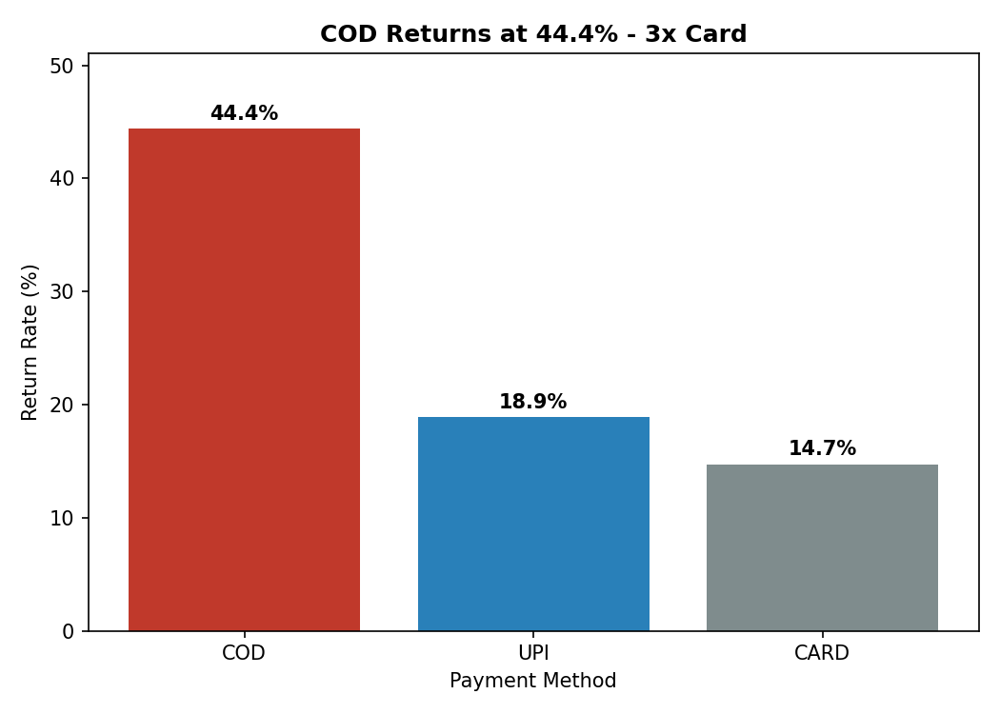
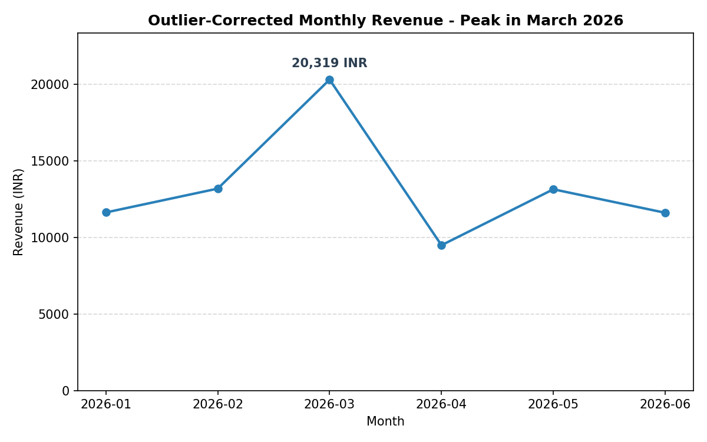

# 📦 Mamaearth Returns & Growth Intelligence Pipeline


End-to-end Mamaearth returns analysis and growth intelligence covering SQL reporting, data cleaning and exploratory data analysis (EDA) using Python and Pandas, and a Gemini-powered Situation-Complication-Resolution (SCR) business narrative with an offline fallback.


**Why are customers returning orders, which payments and cities are the biggest risk, and what does the revenue trend really look like?**

This project analyses the order data of a beauty and personal-care brand. It cleans messy sales data, finds where product returns come from, corrects a misleading revenue trend, and explains the results in a short business story (Situation, Complication, Resolution) written with the help of the Gemini API.

> Capstone project for the **E&ICT Academy, IIT Roorkee** program.

---

## 📑 Contents

1. [Business Problem](#-business-problem)
2. [Project Objectives](#-project-objectives)
3. [Why This Analysis Matters](#-why-this-analysis-matters)
4. [The Data](#-the-data)
5. [Repository Structure](#-repository-structure)
6. [How to Reproduce Every Number](#-how-to-reproduce-every-number)
7. [What Was Done](#-what-was-done)
8. [Visual Insights](#-visual-insights)
9. [Major Findings](#-major-findings)
10. [Business Recommendations](#-business-recommendations)
11. [How This Helps the Business](#-how-this-helps-the-business)
12. [Limitations](#-limitations)
13. [Author](#-author)

---

## 💼 Business Problem

An online beauty brand receives orders paid by **Card, UPI or Cash on Delivery (COD)**. A share of these orders comes back as returns. Every return means lost revenue, extra shipping cost and extra effort for the operations team.

The business wanted clear answers to four questions:

- **Which orders are most likely to be returned?** Is it linked to the payment method, the type of city, or the discount given?
- **How much revenue is the business really earning?** The raw sales data contained mistakes that made the numbers look better than they were.
- **Which months are truly the best?** One month looked like a big success, but something was distorting it.
- **How can these findings be explained simply** to regional operations and finance heads?

---

## 🎯 Project Objectives

- Turn raw, messy order data into a **clean and trustworthy** dataset.
- Find **where returns are concentrated**, by payment method and by city type.
- Test two common beliefs with data: *"COD orders are returned more often"* and *"higher discounts reduce returns"*.
- Show the **real revenue trend** after setting aside unusual bulk orders.
- Produce **two simple charts** that show the main findings at a glance.
- Create a **short business narrative** using only verified numbers, with a backup version that works without internet or an API key.

---

## 🌟 Why This Analysis Matters

| Reason | What it means for the business |
|---|---|
| **Returns are costly** | Knowing where they come from lets the business act on the real cause instead of guessing. |
| **Wrong numbers lead to wrong decisions** | Duplicate orders overstated revenue by **INR 2,501.90**. Two bulk orders made January look like the best month when it was not. |
| **Averages can hide the problem** | The overall COD return rate is high, but one group (COD in Tier-2 cities) is much worse. |
| **Popular ideas can be wrong** | Many teams assume that bigger discounts reduce returns. The data shows almost no link. |
| **Managers need clear answers** | A short, number-checked summary helps decision-makers act quickly. |

---

## 🗂 The Data

Three connected tables, stored in `data/`.

| Table | Size | What it tells us |
|---|---|---|
| **Customers** | 45 customers | City, city type (Tier-1 or Tier-2), sign-up date and acquisition source (Ad, Organic, Referral, Social) |
| **Products** | 16 products | Product name, category (Haircare, Skincare, Babycare, PersonalCare) and price |
| **Orders** | 180 orders | Customer, product, date, quantity, discount, payment method, rating and whether the order was returned |

Every order links to **one customer** and **one product**, so each order can be seen with the full picture: who bought it, what was bought, where the customer lives and how it was paid for. Orders cover **January to June 2026**.

---

## 📁 Repository Structure

```
mamaearth-returns-growth-intelligence/
│
├── README.md
├── requirements.txt
│
├── data/
│   ├── customers.csv
│   ├── products.csv
│   └── orders.csv
│
├── sql/
│   ├── schema.sql
│   ├── seed_data.sql
│   └── reports.sql
│
├── analysis/
│   ├── clean_and_eda.py
│   └── visualize.py
│
├── notebooks/
│   ├── final_clean.ipynb
│   ├── visualize.ipynb
│   └── generate_narrative.ipynb
│
├── visualizations/
│   ├── return_rate_by_payment.png
│   └── monthly_revenue_trend.png
│
└── narrator/
    ├── findings.json
    ├── generate_narrative.py
    └── sample_output.txt
```

---

## ▶️ How to Reproduce Every Number

Follow the three steps **in order**. Run all commands from the **root folder of the repository**.

**Requirements:** MySQL Workbench for Step 1, and Python 3.9 or newer for Steps 2 and 3. Install the Python libraries once:

```bash
pip install -r requirements.txt
```

`requirements.txt` contains: `pandas`, `numpy`, `matplotlib`, `seaborn`, `google-genai`.

### Step 1: SQL (schema, data and reports)

1. Open **MySQL Workbench** and connect to your local server.
2. Create an empty database and select it:
   ```sql
   CREATE DATABASE mamaearth;
   USE mamaearth;
   ```
3. Open `sql/schema.sql` and run it. This creates the `customers`, `products` and `orders` tables.
4. Open `sql/seed_data.sql` and run it. This loads all the rows.
5. Check the row counts: **45 customers, 16 products, 180 orders**.
6. Open `sql/reports.sql` and run it. The result of each report is written as a comment above its query.

Notes for `reports.sql`:
- Report (i) changes the `customers` table, so it is the **last** report. To run `reports.sql` a second time, run `schema.sql` and `seed_data.sql` again first.
- MySQL Workbench blocks updates without a `WHERE` condition (Error 1175). The line `SET SQL_SAFE_UPDATES = 0;` before the update in report (i) fixes this.

**Numbers you should see:**

| Report | Expected result |
|---|---|
| (a) Order totals | 180 orders, total revenue **99,860.20**, average order value **554.78** |
| (b) Missing ratings | `COUNT(*)` 180, `COUNT(rating)` 165, difference **15** |
| (c) Customers with no orders | **C045, Vihaan** (same result from the join and the subquery) |
| (d) Cities with return rate above 20% | **Jaipur** 19 orders, 8 returned, 42.1%; **Lucknow** 49, 15, 30.6%; **Bangalore** 33, 8, 24.2% |
| (e) Top 5 customers by spend | C043 12,920.00; C026 8,371.60; C008 4,564.60; C011 4,111.00; C042 3,785.00 (ranks 3 to 5 shown again with `OFFSET`) |
| (f) Revenue by category | Haircare 44,956.10; Skincare 27,346.00; Babycare 16,805.00; PersonalCare 10,753.10 |
| (g) Names starting with "A" | 10 customers |
| (h) Acquisition sources | Ad, Organic, Referral, Social |
| (i) Loyalty tier | Gold **28**, Silver **17** |

### Step 2: Python analysis and charts

Run the two scripts in this order:

```bash
python analysis/clean_and_eda.py
python analysis/visualize.py
```

**`clean_and_eda.py`** reads the raw files in `data/`, prints every intermediate result, and, as its last step, **writes `narrator/findings.json`** (the findings-export step, Task 5 of Part 2 in the project brief; Task 12 in the notebook version). The file is created by code and never typed by hand, so it always matches the analysis.

**`visualize.py`** imports `clean_and_eda.py`, so it always uses fresh numbers. It saves two charts in `visualizations/`: `return_rate_by_payment.png` and `monthly_revenue_trend.png`.

**Numbers you should see:**

| Task | Expected result |
|---|---|
| Load | Customers `(45, 6)`, products `(16, 4)`, orders `(180, 9)` |
| Payment casing | 7 raw spellings become 3: CARD 70, UPI 55, COD 55 |
| Duplicates | 5 removed: **O0176, O0177, O0178, O0179, O0180**; cleaned orders `(175, 9)` |
| Missing values | 12 discounts and 15 ratings filled; median rating **3.0** |
| Cleaned revenue | **97,358.30**; raw total 99,860.20; difference **2,501.90** (equal to the 5 duplicates) |
| Outliers (IQR on quantity) | Q1 1.0, Q3 2.0, IQR 1.0, limits -0.5 and 3.5; **2 outliers: O0011 (25), O0098 (30)** |
| Return rate by payment | CARD **14.7%**, COD **44.4%**, UPI **18.9%** |
| Highest-risk segment | **COD + Tier-2: 54.5%** (22 orders); COD Tier-1: 37.5% (32 orders) |
| Correlations | All six pairs negligible; discount vs returned **-0.088** |
| Monthly revenue, with outliers | Jan 29,582.10; Feb 13,195.50; Mar 20,318.90; Apr 9,495.30; May 13,151.10; Jun 11,615.40 |
| Monthly revenue, without outliers | Jan **11,637.10** (other months unchanged); true peak **March, 20,318.90** |

The notebooks in `notebooks/` show the same steps one task per cell, with the output and an observation after each. In Google Colab, upload the three CSV files to a Drive folder called `IITR_Capstone_Project` and run the cells from top to bottom.

### Step 3: Gemini narrator (with or without an API key)

Run the narrator from the repository root. It reads `narrator/findings.json`, which Step 2 created:

```bash
python narrator/generate_narrative.py
```

**Option A: with a Gemini API key (online path)**

Get a **free** key from Google AI Studio (https://aistudio.google.com). Never use a paid-only key, and never commit the key to GitHub. Set it as an environment variable before running the script.

| System | Command |
|---|---|
| macOS / Linux | `export GEMINI_API_KEY="your-key"` |
| Windows (PowerShell) | `$env:GEMINI_API_KEY="your-key"` |
| Windows (Command Prompt) | `set GEMINI_API_KEY=your-key` |
| Google Colab | Add `GEMINI_API_KEY` under **Secrets** (key icon in the left panel) and turn on notebook access |

Then run the script. To also save the narrative as the sample output, add `--save-sample`:

```bash
python narrator/generate_narrative.py --save-sample
```

This writes `narrator/sample_output.txt`. The first line printed shows `Source: gemini`.

**Option B: with no API key (offline path)**

Run the same command **without setting any key**:

```bash
python narrator/generate_narrative.py
```

No configuration, network or key is needed. The script builds the same three sections (Situation, Complication, Resolution) from a template filled with the numbers in `findings.json`. The first line printed shows `Source: offline`. The offline path is also used automatically if the Gemini call fails.

**Accuracy check:** after the narrative is printed, a checker prints one PASS or FAIL line for each of the five required figures. For the Gemini path, the output is also saved in `narrator/sample_output.txt` and checked again, because AI output can vary slightly between runs.

| # | Figure the narrative must contain |
|---|---|
| 1 | **97,358.30** (cleaned total revenue) |
| 2 | **44.4** (COD return rate) |
| 3 | **54.5** (COD + Tier-2 return rate) |
| 4 | **2,501.90** (duplicate reconciliation difference) |
| 5 | **March** with **20,318.90** (true peak month) |

The offline path always passes all five.

---

## 🔎 What Was Done

### Part 1: Business reporting with SQL
A small database was built from the three tables and nine business reports were written. They cover total orders and revenue, missing ratings, customers who never ordered, cities with a high return rate, top spenders, revenue by category, customer groups and a loyalty tier.

### Part 2: Data cleaning and exploratory analysis

| Step | The issue | What was done | Result |
|---|---|---|---|
| **Inconsistent spellings** | The same payment method was written in 7 ways | Made them consistent | **3 clean payment methods** |
| **Duplicate orders** | 5 orders were submitted twice | Removed the extra copies | 175 genuine orders |
| **Missing values** | 12 discounts and 15 ratings were blank | No recorded discount was treated as zero; missing ratings got the typical (median) rating of 3.0 | No blanks left |
| **Combining the tables** | Order, product and customer details were separate | Joined them into one view | Cleaned revenue **INR 97,358.30** |
| **Unusual orders** | Two orders had 25 and 30 units, while most have 1 to 2 | Marked as outliers, but kept | Orders **O0011** and **O0098** |

**Reconciliation:** the gap between the original total (INR 99,860.20) and the cleaned total (INR 97,358.30) is **INR 2,501.90**. It equals the value of the 5 duplicate orders exactly, so nothing else changed the revenue.

Further analysis covered return rates by payment method and by city type, the relationship between rating, returns, discount and quantity, and monthly revenue with and without the two bulk orders. Heatmaps showed where data was missing before and after cleaning, and a box plot showed the two unusual orders.

### Part 3: AI-written business narrative
The verified numbers were saved in a structured file. Google Gemini then used **only those numbers** to write a Situation, Complication and Resolution summary. Safeguards:
- The AI is told never to invent numbers.
- It is set to give consistent, factual answers rather than creative ones.
- A backup template writes the same story without internet or a key.
- A checker confirms that the five key figures appear in the text.

---

## 📊 Visual Insights

### Return rate by payment method


COD stands far above the other two payment methods at **44.4%**. Bars run from highest to lowest, so the problem is visible straight away.

### Monthly revenue after setting aside bulk orders


Without the two bulk orders, **March 2026** is clearly the best month, at **INR 20,318.90**.

---

## 🔑 Major Findings

### 1. Cash on Delivery is the biggest source of returns

| Payment method | Orders | Return rate |
|---|---|---|
| **COD** | 54 | **44.4%** |
| UPI | 53 | 18.9% |
| Card | 68 | 14.7% |

COD is about **31% of orders** but **24 of the 44 returned orders**, which is more than half of all returns. COD orders come back about **3 times as often as Card orders**.

### 2. The biggest risk is COD in Tier-2 cities

| Payment method | Tier-1 cities | Tier-2 cities |
|---|---|---|
| Card | 8.9% | 26.1% |
| **COD** | 37.5% | **54.5%** |
| UPI | 19.4% | 18.2% |

In Tier-2 cities, **more than half of COD orders (54.5%) come back**. The overall COD figure of 44.4% hides this. Card also performs worse in Tier-2 cities, while UPI stays steady in both city types.

### 3. Some cities have unusually high return rates
Jaipur (42.1%), Lucknow (30.6%) and Bangalore (24.2%) return more than 1 in 5 orders.

### 4. Discounts do not reduce returns
All relationships between rating, returns, discount and quantity are very weak. The link between discount and returns is only **-0.088**, so the belief that bigger discounts mean fewer returns is **not supported**. Payment method and city type explain returns much better.

### 5. Revenue was overstated and the best month was misread

| Month | With bulk orders (INR) | Without bulk orders (INR) |
|---|---|---|
| January | 29,582.10 | 11,637.10 |
| February | 13,195.50 | 13,195.50 |
| **March** | 20,318.90 | **20,318.90** |
| April | 9,495.30 | 9,495.30 |
| May | 13,151.10 | 13,151.10 |
| June | 11,615.40 | 11,615.40 |

January only looked best because of two bulk orders (O0011 and O0098). **March is the real peak** and **April is the weakest month**.

### 6. Customer and product behaviour
- **Haircare earns the most** (INR 44,956.10, about 45% of the original revenue figure). Skincare has the most orders (60).
- **Spending is concentrated:** the top customer spent INR 12,920.00 against an average order of about INR 554.78.
- One registered customer has **never placed an order**.
- **15 orders have no rating**, so feedback is not captured for every sale.

---

## 💡 Business Recommendations

| # | Recommendation | Why (from the analysis) |
|---|---|---|
| 1 | **Confirm COD orders before dispatch**, starting with Tier-2 cities | COD in Tier-2 cities has a 54.5% return rate, the highest of any group |
| 2 | **Encourage prepaid payment** with a small reward, and test whether it moves customers away from COD | Card (14.7%) and UPI (18.9%) come back far less often than COD (44.4%) |
| 3 | **Do not use bigger discounts to cut returns** | The link between discount and returns is almost zero |
| 4 | **Look into Tier-2 Card orders** | Card returns are 26.1% in Tier-2 versus 8.9% in Tier-1 |
| 5 | **Review the high-return cities** (Jaipur, Lucknow, Bangalore) for delivery or product-expectation issues | All three are above a 20% return rate |
| 6 | **Judge monthly performance without bulk orders**, and study what made March strong | March is the true peak, while January's lead came only from two bulk orders |
| 7 | **Look closely at April** | It is the weakest month at INR 9,495.30 |
| 8 | **Stop duplicate orders at the source** and review very large orders before reporting | Duplicates inflated revenue by INR 2,501.90 and bulk orders distorted January |
| 9 | **Collect more ratings** | 15 orders have no rating |
| 10 | **Reconnect with the customer who never ordered**, and consider a loyalty programme using the Gold and Silver groups | One customer has no orders, and customers already split into 28 Gold and 17 Silver |

---

## 🚀 How This Helps the Business

| Goal | How the analysis helps |
|---|---|
| **Reduce product returns** | Shows exactly where returns come from (COD, especially in Tier-2 cities), so effort goes where it matters most. |
| **Improve payment-method performance** | Shows that Card and UPI orders are far more reliable than COD, and that Card needs attention in Tier-2 cities. |
| **Understand customer behaviour** | Shows which cities and customer groups exist, who spends the most, and how return behaviour differs between city types. |
| **Find revenue growth opportunities** | Shows the true peak month (March), the weak month (April) and the strongest category (Haircare). |
| **Trust the numbers** | Cleaned data, a reconciled revenue total and checked figures keep decisions based on correct information. |

---

## ⚠️ Limitations

- The dataset is small (180 orders before cleaning, 175 after), so patterns such as COD in Tier-2 cities (22 orders) are clear but should be confirmed with more data.
- The analysis shows **where** returns are high, not **why**. Customer feedback or return reasons would be needed to find the causes.
- The AI-written narrative can vary slightly between runs. That is why the saved sample is checked against the verified numbers and why a fixed-template backup is included.

---

## 👤 Author

**Shubham Jeware**, BI / Data Analyst
